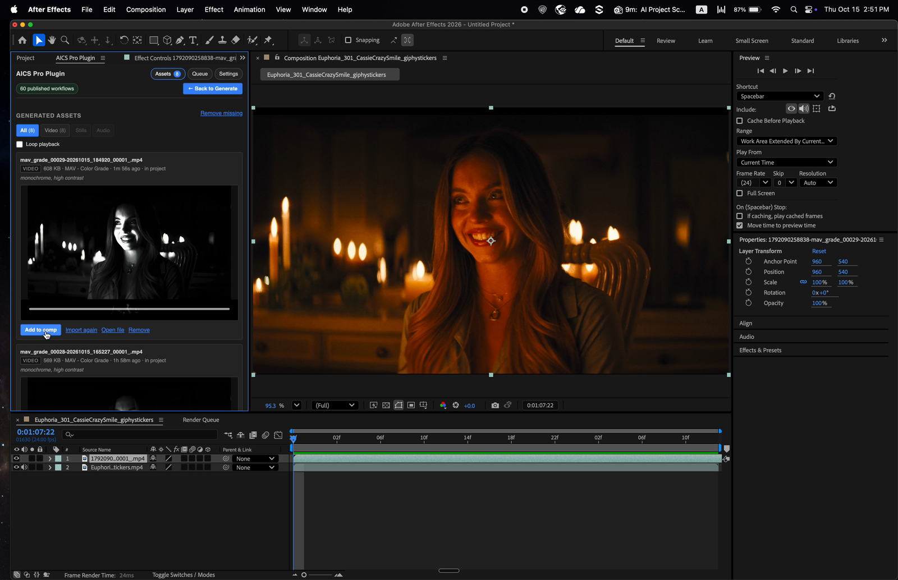
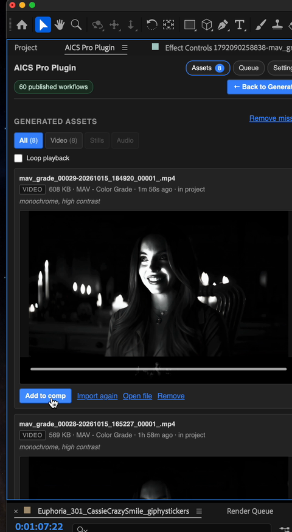

# AICS Pro Plugin

A panel inside **After Effects** that runs AI on a shot from your timeline and
puts the result back into the project. Color-grade a clip, generate a new one
from a prompt, upscale, add sound — then drop it on the timeline and keep
editing.

This repository holds the installer. The source is kept privately elsewhere.


The clip above is a color grade: the original is black and white, the plugin
returns the warm candlelit version.

<p>
  
  
</p>

The panel sits in After Effects next to your comp. When a job finishes, the
result lands in **Assets** so you can preview it and add it to the timeline.



## Install

Close After Effects first.

**Mac** — the same command installs and updates:

```bash
curl -fsSL https://github.com/djkim-wbd/after-effects-aics-plugin-dist/releases/latest/download/install | bash
```

**Windows:**

```powershell
irm https://github.com/djkim-wbd/after-effects-aics-plugin-dist/releases/latest/download/install.ps1 | iex
```

### Prefer not to use the Terminal?

1. Open the [latest release](https://github.com/djkim-wbd/after-effects-aics-plugin-dist/releases/latest).
2. Download **AICS-Pro-Plugin.zip** and unzip it.
3. Double-click **Install AICS Pro Plugin** (Mac) or **Install AICS Pro Plugin.bat** (Windows).
4. If Mac says it can’t be opened, right-click it → **Open** → **Open**.

The installer copies the panel into After Effects for you.

## The first time you open it

1. Open **After Effects**.
2. Open **Preferences → Scripting & Expressions** (on Windows that is under **Edit**).
3. Tick **Allow Scripts to Write Files and Access Network**. The panel cannot
   export frames or save results without this.
4. Choose **Window → Extensions → AICS Pro Plugin**.
5. Click **Settings** in the panel, paste the tool key your team gave you, and
   click **Connect**.



## How to use it

1. Open the composition you want to work on.
2. In the panel, pick a workflow (for example a color grade, an upscale, or
   image-to-video).
3. Choose the source — a frame under the playhead, the work area, or a file
   already in the project.
4. Press **Run**. You can keep editing while it works; the **Queue** tab shows
   progress.
5. When it finishes, open **Assets**, preview the result, and click **Add to
   comp**.

A [short screen recording](docs/demo.mp4) of the before/after above is in this
repo if you want to watch it as a video instead of the GIF.

## What you need

- After Effects CC 2019 or newer, on a Mac or a Windows PC
- A tool key from your team (paste it once in Settings)
- That scripting preference from the first-launch list

## Uninstall

Delete the folder `com.aicspro.aftereffects` from:

- **Mac:** `~/Library/Application Support/Adobe/CEP/extensions/`
- **Windows:** `%APPDATA%\Adobe\CEP\extensions\`

Then restart After Effects.

## Reporting something

Say which workflow you ran, what you sent it (a frame, a clip, a prompt), and
what you expected instead.
